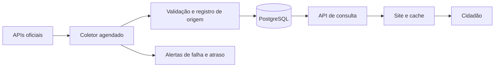

# Tecnologias e atualização dos dados

Status: recomendação, sujeita à aprovação do escopo e do orçamento. Data: 29/10/2026.

## Stack proposta

| Camada | Escolha | Motivo |
| --- | --- | --- |
| Site | Next.js, React e TypeScript | HTML renderizado no servidor e páginas cacheadas para conteúdo público pesquisável |
| Interface | Tailwind CSS | Consistência visual e responsividade |
| API e ingestão | Python, FastAPI, Pydantic, SQLAlchemy e Alembic | Validação, integração com fontes e migrações versionadas |
| Dados | PostgreSQL em container Docker na VPS, sem Supabase | Relações, histórico e busca textual inicial; hospedagem do banco em Docker confirmada pelo usuário |
| Coletas | Processo Python separado, acionado por timers do sistema | Agendamento simples com bloqueio de concorrência e histórico no banco |
| Infraestrutura | Linux LTS, Docker Compose e Nginx | Avaliar primeiro a VPS Hostinger existente; uso condicionado à disponibilidade e ao isolamento |
| Proteção e cache | Cloudflare | DNS, distribuição de conteúdo e proteção de borda, conforme plano |
| Versionamento | Git e GitHub; verificações automatizadas no CI | Revisão, histórico e entregas reproduzíveis |

Next.js substitui a ideia de uma interface React exclusivamente no navegador. A necessidade de páginas públicas indexáveis favorece pré-renderização/SSR, conforme a [documentação de renderização do Next.js](https://nextjs.org/learn/seo/rendering-strategies). Isso não garante posição no Google.

Manter regras de dados no backend; o frontend apresenta os resultados. Duas linguagens aumentam a manutenção, mas permitem aproveitar a familiaridade com Python/FastAPI e React. Fixar versões estáveis e suportadas no início da implementação, após verificar compatibilidade e avisos de segurança; não fixar versões especulativas neste documento.

Redis, Celery, Elasticsearch e Kubernetes ficam fora da base inicial. Adicionar fila ou busca dedicada apenas se medições justificarem. O usuário pretende substituir o Sycon Suite e dedicar a VPS ao novo projeto. Não reutilizar banco ou credenciais do Sycon. A substituição é uma intenção de planejamento, não uma ordem de remoção nesta etapa; preservar dados e possibilidade de retorno antes da transição.

## Banco em Docker

Decisão do usuário: banco em Docker, sem Supabase. Manter PostgreSQL como tecnologia proposta e executá-lo como serviço próprio no Docker Compose da VPS, separado da API e do frontend. Não há contratação de banco gerenciado prevista.

- Volume nomeado persistente para o diretório de dados: recriar o container não deve apagar o banco. Remover o volume pode destruir os dados; volume não é backup.
- Rede interna do Docker; não publicar a porta do PostgreSQL na internet. Acesso administrativo eventual por túnel SSH ou VPN, com configuração restrita.
- Credenciais fora do repositório e imagens; usuários distintos para consultas, ingestão e migrações.
- Fixar versão suportada da imagem, configurar healthcheck e política de reinício, limitar conexões e dimensionar memória para a VPS de 4 GB.
- Backups consistentes diários enviados para fora da VPS e restauração testada. Cópia apenas no mesmo disco não atende à política de recuperação.
- Atualizações de versão principal exigem procedimento de migração e teste; não trocar a imagem por uma versão maior indiscriminadamente.

A equipe assume administração, atualizações e recuperação do banco. Banco e aplicação no mesmo host compartilham sua indisponibilidade. O Compose local e os Dockerfiles foram implementados e executados. Conexão real com PostgreSQL e persistência após recriar seu container foram verificadas. A validação na VPS continua pendente.

## Fluxo de dados

O navegador consulta nossa aplicação. A ingestão não ocorre a cada visita. O site pode servir o último dado confirmado durante indisponibilidade externa, com aviso de atualização atrasada.

## Automático versus manual

**Proposta: coleta automática por API, revisão humana nas exceções.** Não prometer tempo real: frequência de consulta não equivale à frequência de publicação do órgão.

| Conteúdo | Frequência proposta | Observação |
| --- | --- | --- |
| Votações e tramitação recente | A cada 15 minutos | Priorizar janela recente; ajustar após medir volume e limites |
| Proposições e tramitações fora da janela recente | Reconciliação diária | Reconsultar registros ativos de forma distribuída |
| Dados cadastrais e mandatos | Diária | Preservar histórico de alterações |
| Emendas, despesas e transferências, quando integradas | Diária | Pode haver defasagem da própria fonte |
| Histórico e correções retroativas | Semanal e sob demanda | Processamento limitado, sem competir com atualização recente |

São metas de agendamento, ainda sem validação operacional. Mostrar data do evento, data de coleta e atualização da fonte quando disponível. Invalidar/revalidar o cache após publicação dos dados; cache também pode acrescentar atraso.

Intervenção manual: investigar falhas, validar mudanças de formato, reexecutar coletas e registrar correções editoriais. Não depender de digitação diária de votos ou valores. Se uma fonte não tiver API, avaliar primeiro arquivos oficiais em lote; scraping exige avaliação específica de estabilidade, permissões e custo.

## Fontes e restrições conhecidas

| Fonte | Aplicação | Pendência técnica |
| --- | --- | --- |
| [Câmara](https://dadosabertos.camara.leg.br/swagger/api.html) | Deputados, proposições e votações | Testar paginação, volume, filtros e cobertura por endpoint |
| [Senado](https://legis.senado.leg.br/dadosabertos/api-docs/swagger-ui/index.html) | Senadores e processo legislativo | Mapear diferenças de modelo e histórico |
| [Portal da Transparência](https://api.portaldatransparencia.gov.br/) | Emendas e despesas federais | Obter credencial e validar vínculos financeiros |

O [cadastro da API do Portal da Transparência](https://portaldatransparencia.gov.br/api-de-dados/cadastrar-email) exige autenticação e entrega de token. A página consultada informa limites de 700 requisições/minuto entre 00h e 06h, 400 nos demais horários e 180 para APIs restritas. São tetos publicados, não metas de uso; revalidar condições e fuso antes da integração. O token fica apenas no servidor.

## Requisitos de ingestão

- Identificadores compostos por fonte e ID externo; não unir homônimos por nome.
- Gravar origem, horário de coleta, versão do normalizador e hash do conteúdo. Reter payloads relevantes com acesso restrito e política de minimização.
- Atualização idempotente, checkpoints e publicação transacional; evitar exibir metade de uma importação como resultado completo.
- Timeouts, tamanho máximo de resposta, paginação limitada e retentativas progressivas com variação aleatória; respeitar Retry-After quando presente.
- Um trabalho por fonte/janela de cada vez, com mecanismo para recuperar execução interrompida.
- Mudança inesperada de schema ou queda anormal no número de registros gera alerta e quarentena; não apaga o banco automaticamente.
- Validar totais financeiros, status e duplicações; Decimal para dinheiro e datas de negócio em America/Sao_Paulo.
- Separar consulta pública com permissões mínimas do usuário de escrita dos coletores e do usuário de migração.

## Dimensionamento inicial

Máquina existente informada: Hostinger KVM 1, 1 núcleo de CPU, 4 GB de RAM, 50 GB de disco e 4 TB de largura de banda. O usuário pretende substituir o Sycon Suite e usar a máquina exclusivamente para este projeto. A hipótese anterior de 2 vCPU era uma referência de compra, não requisito mínimo comprovado.

**Avaliação preliminar:** configuração plausível para o MVP federal com tráfego inicial moderado, cache e ingestão incremental controlada. Não há necessidade de upgrade demonstrada. Um núcleo de CPU é o principal ponto de atenção durante importações, consultas pesadas e renderização concorrente; 50 GB exigem limitar histórico bruto e arquivos. Não significa capacidade validada para cobertura nacional completa, todo o histórico ou picos grandes de acesso.

Antes da transição: inventariar e preservar banco, anexos, configurações e versão do Sycon em backup externo protegido, testar restauração e definir janela de parada e plano de retorno. A troca efetiva será uma etapa posterior, sem remoção agora. Testar o novo projeto em ambiente isolado; não executar ensaio de carga diretamente sobre a produção do Sycon. Após desligar o serviço antigo conforme o plano, confirmar recursos disponíveis e validar o novo serviço antes de liberar acesso público.

Fazer builds fora da VPS, limitar memória/CPU da ingestão e executar coletas pesadas sem concorrência. Reservar disco para sistema, logs, banco, imagens e cópias temporárias; evitar hospedar PDFs/vídeos e reter payloads sem limite. Carga de planejamento: até 10 mil visitas/mês, três páginas por visita e picos de teste de dez usuários simultâneos. Esses valores são hipóteses para ensaio, não capacidade garantida. A premissa é não manter o Sycon executando simultaneamente após a transição. O servidor único permanece sem alta disponibilidade.

Antes do lançamento, medir tamanho da base, duração da carga inicial, RAM, CPU e latência em ambiente semelhante à produção. Reavaliar ao manter disco acima de 70%, RAM acima de 80%, filas atrasadas ou consultas lentas. Crescimento do histórico e consultas pesadas podem custar mais do que o número de visitas sugere.
